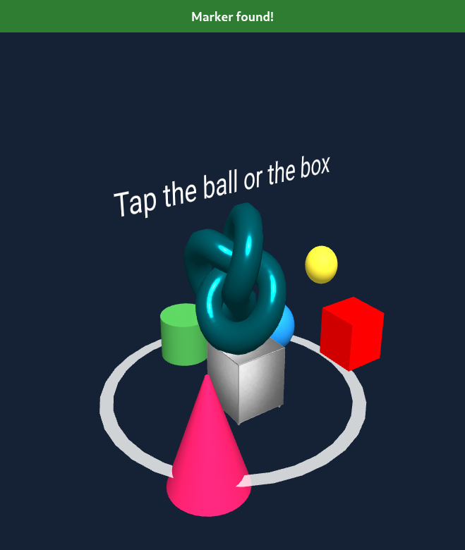

# Group 6 · Interactive Web AR

## How it works

Point your webcam at a [Hiro marker](https://raw.githubusercontent.com/AR-js-org/AR.js/master/data/images/hiro.png) and AR.js tracks it, placing a 3D safe vault and a set of animated shapes on top of it with A-Frame. Tap the ball to change its color, or tap the box to make it grow. Everything runs in the browser from a single HTML page, with no build step and no backend.

## Credits

- **“Safe Vault”** by **Ariel Alves** — [original model](https://skfb.ly/6CwDC), licensed under [CC BY 4.0](https://creativecommons.org/licenses/by/4.0/).
- **A-Frame** — [website](https://aframe.io/) · [source (MIT)](https://github.com/aframevr/aframe).
- **AR.js** — [source (MIT)](https://github.com/AR-js-org/AR.js).
