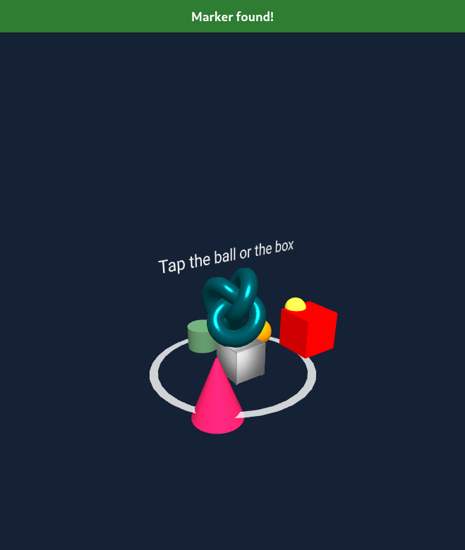
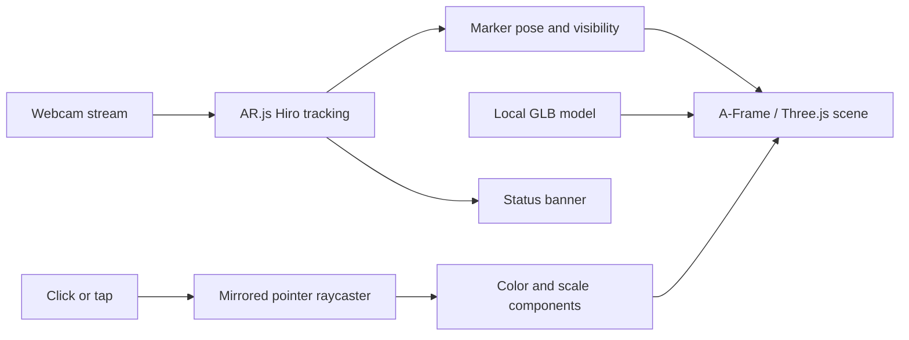

<div align="center">

# Group 6 · Interactive Web AR

**An interactive augmented reality playground, built for the browser.**

Bring a 3D vault and animated objects into your camera view with a Hiro marker.


[Quick start](#quick-start) · [Features](#the-experience) · [Architecture](#how-it-works) · [Deployment](#deployment) · [Credits](#credits)

</div>


> **Screenshot context:** This is a browser capture of the real WebGL scene. Webcam permission was denied during testing, so marker visibility, the status event, camera viewpoint, and background were temporarily controlled in the browser. This preview does not demonstrate physical marker detection. Application source was unchanged.

## Overview

Group 6 is a marker-based augmented reality assignment combining webcam tracking, a binary glTF model, continuous animation, and custom tap interactions. Open the page, allow camera access, and point the camera at a Hiro marker to reveal the scene.

The application consists of one HTML page and a local 3D model. There is no package installation, build step, backend, database, or account system. A-Frame and AR.js load from external CDNs.

## The experience

| Element | Behavior |
| --- | --- |
| Safe vault | Local GLB model positioned at the marker's center. |
| Cyan torus knot | Rotates around two axes over a six-second cycle. |
| Yellow sphere | Orbits the scene every three seconds. |
| Interactive ball | Tapping cycles through orange, pink, light green, yellow, and blue. |
| Red box | Bobs vertically; tapping toggles between its original size and twice that size with a 300 ms animation. |
| Pink cone | Pulses between its original scale and 1.4× scale. |
| Cylinder | Transitions between green and purple. |
| Ground ring | Rotates beneath the scene. |
| Status banner | Displays searching, marker found, or marker lost states. |

The video and canvas are mirrored horizontally. A custom raycaster reverses the pointer's horizontal coordinate to align taps with the mirrored view. The instruction text is counter-scaled for readability.

<details>
<summary><strong>Interaction preview</strong> — changed ball color and enlarged box</summary>



Captured in the same controlled browser session. Click events were dispatched to the real components; physical taps and tracking still require device testing.

</details>

## Quick start

### Requirements

- A current browser with WebGL and webcam support, a working camera, and permission to use it.
- Internet access for external libraries and their runtime resources.
- Python 3 **or** PHP for a local static server.
- A Hiro marker on another screen or printed on paper.

### Run locally

```bash
git clone https://github.com/Posandu/group-6-assignment.git
cd group-6-assignment
python3 -m http.server 8080
```

Open **[http://localhost:8080](http://localhost:8080)** and allow camera access. Keep the terminal running while using the app.

Alternatively, serve the same directory with PHP:

```bash
php -S localhost:8080
```

Use a local server instead of opening the HTML with a `file://` URL.

### Reveal the scene

1. Open the [Hiro marker image](https://raw.githubusercontent.com/AR-js-org/AR.js/master/data/images/hiro.png) on another screen or print it with its full border intact.
2. Open the app and allow camera access.
3. Keep the entire marker border visible in good light.
4. Wait for **“Marker found!”** and the scene to appear.
5. Tap the ball to change its color. Tap the box to enlarge it, then tap again to restore its size.
6. Move the marker out of view to check the **“Marker lost”** state.

For phone testing, use an **HTTPS deployment**. A plain HTTP address on your computer's local network generally does not satisfy the phone browser's secure-context requirement for camera access. `localhost` refers to the device opening the page.

## How it works



| Layer | Implementation |
| --- | --- |
| Scene framework | **A-Frame 1.3.0**, served from `aframe.io`. |
| Marker tracking | **AR.js 3.4.5**, served from jsDelivr; built-in `hiro` preset. |
| Rendering and hit testing | Three.js objects and raycasting exposed through A-Frame. |
| 3D asset | Binary glTF (`.glb`), loaded through A-Frame's asset system. |
| Interaction | Vanilla JavaScript: `mirrored-tap`, `change-color`, and `toggle-grow`. |
| Tracking feedback | `marker-status` listens for `markerFound` and `markerLost`. |
| Presentation | Inline CSS, mirrored video/canvas, and a fixed status banner. |
| Hosting | Static files; HTTP locally and HTTPS for public camera access. |

Ambient and directional lights illuminate the scene. A-Frame animations drive rotation, orbiting, position, scale, and material-color changes. The app requests a 1280 × 960 camera source and display size; actual capture depends on the browser and device.

### Repository layout

```text
.
├── index.html                       # Scene, styles, and custom components
├── safe_vault.glb                    # Attributed 3D model
├── docs/images/
│   ├── scene-preview.png            # Controlled scene rendering
│   ├── interaction-preview.png      # Color and scale interaction state
│   └── camera-permission.png        # Actual permission-denied state
└── README.md
```

## Deployment

Publish as a **static website**. Serve `index.html` and `safe_vault.glb` from the same directory, preserving the relative model path. No build command, environment variables, application server, or secrets are required.

### GitHub Pages

1. Push the project to GitHub.
2. Open **Settings → Pages** in the repository.
3. Choose **Deploy from a branch**.
4. Select `main` and `/ (root)`, then save.
5. Open the HTTPS address GitHub reports after deployment completes.

The conventional address is `https://posandu.github.io/group-6-assignment/`. **It returned HTTP 404 during verification on November 5, 2026, and is not a confirmed live demo.** Use the URL shown in Pages settings once deployment is available.

### Other hosting options

| Host | Configuration |
| --- | --- |
| Netlify | Import the repository, leave the build command empty, and publish the repository root (`.`). |
| Vercel | Import as an **Other** project, disable the build command, and serve the repository root. |
| Existing web server | Copy the HTML and model to the same public directory and enable HTTPS. |

After deployment, verify camera permissions, marker acquisition, model loading, and both tap interactions on the target device. External script hosts must remain reachable.

## Troubleshooting

| Symptom | What to check |
| --- | --- |
| `NotAllowedError` or permission denied | Allow camera access in browser site settings, check operating-system permissions, and reload. |
| Camera unavailable on a phone | Use HTTPS; a remote HTTP LAN address is generally insufficient. |
| Status stays on “Searching” | Check lighting, focus, marker size, and visibility of the full Hiro border. |
| Model or scripts fail to load | Check file paths, browser network errors, and CDN connectivity. |
| Objects disappear | Keep the marker in view; scene visibility follows tracking. |
| Taps do not register | Tap the visible ball or box while tracking is active. Only these objects have click actions. |
| Rendering is slow | Try a device with stronger WebGL support and close competing camera or graphics applications. |

<details>
<summary>Camera-permission state captured during local testing</summary>


</details>

## Verification notes

The project was served locally with PHP and inspected in a browser on **November 5, 2026**.

- The page and GLB asset returned HTTP 200.
- A-Frame initialized, all four custom components registered, and the vault mesh loaded.
- Dispatching a click to the ball changed its material from `#2196f3` to `#ff9800`.
- Dispatching clicks to the box changed its scale from `0.3 0.3 0.3` to `0.6 0.6 0.6`, then restored its original scale.
- Screenshots show the running app with temporary browser-only rendering overrides.
- Webcam permission was denied. Physical marker acquisition, tracking stability, mirrored pointer hit testing, and mobile camera behavior were **not verified**.

The repository has no automated test suite or build pipeline. These checks are a bounded smoke test, not complete browser or device coverage.

## Credits

- **“Safe Vault”** by **Ariel Alves** — [original model](https://skfb.ly/6CwDC), licensed under [Creative Commons Attribution 4.0 International](https://creativecommons.org/licenses/by/4.0/).
- **A-Frame** — [website](https://aframe.io/) · [source and MIT license](https://github.com/aframevr/aframe).
- **AR.js** — [source and MIT license](https://github.com/AR-js-org/AR.js).

The repository does not currently include a project-level license file. Third-party licenses apply to their respective libraries and assets; they do not establish a license for the assignment's own source code.
